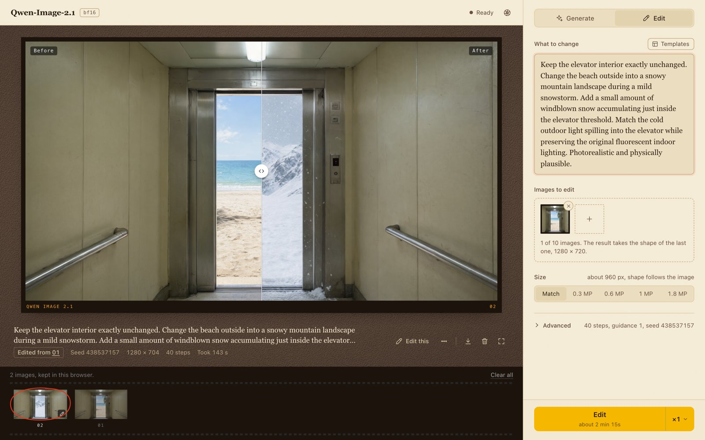
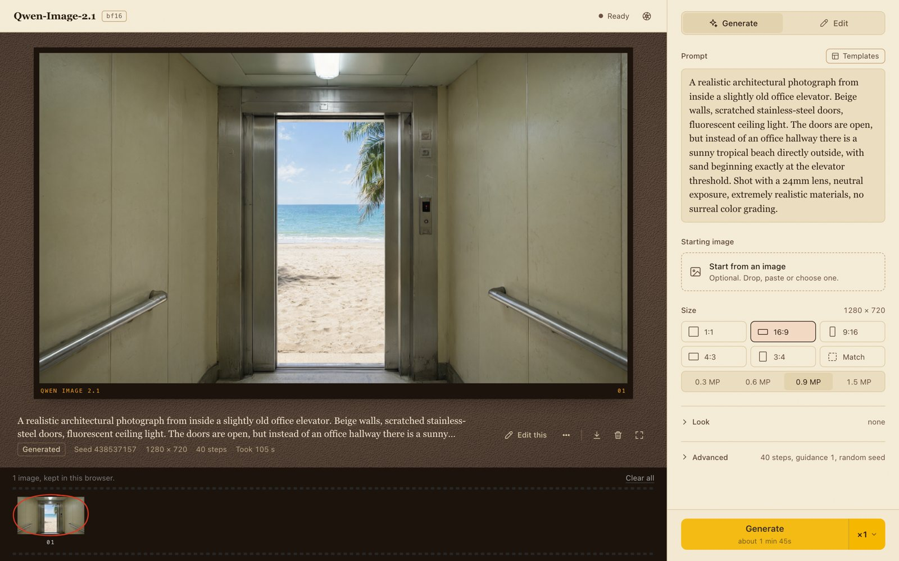
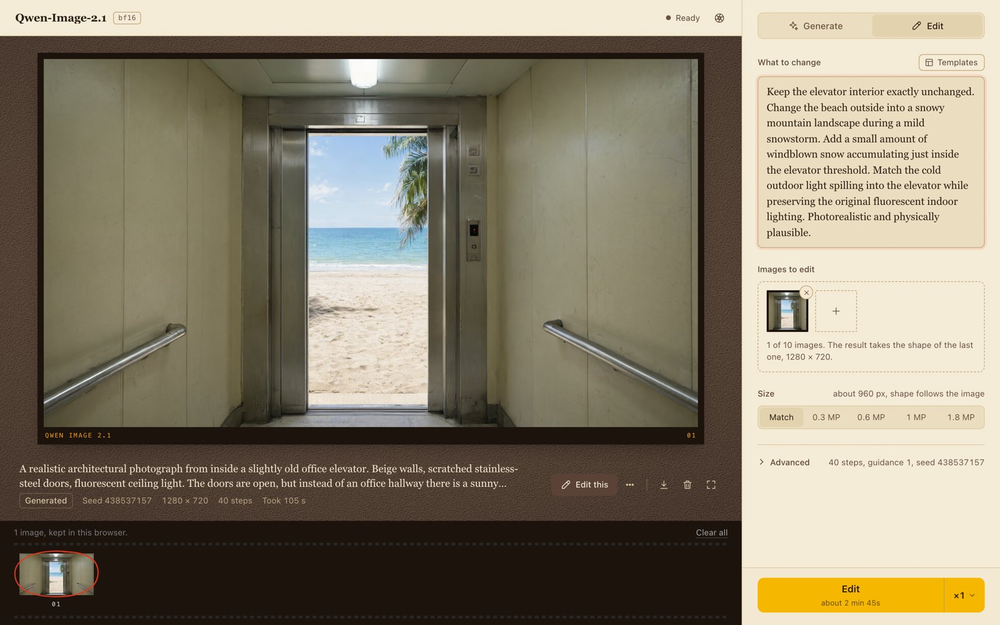
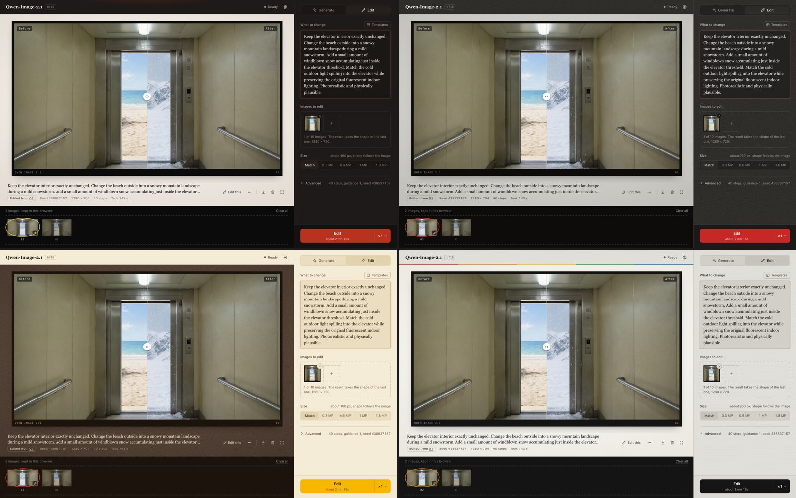

<h1 align="center"><br>image-gen</h1>

A local multimedia studio for images, video, and Voice on Apple Silicon.
Write prompts, share references, and generate speech from a script.
The server retains recent results in memory for API clients and open tabs.
Your browser keeps selected results until you clear them.



## Get started

This walk-through makes the image above: first a beach outside an elevator, then the same elevator in a snowstorm. It needs a Mac with Apple Silicon and [uv](https://docs.astral.sh/uv/). It was built on a machine with 64 GB of memory.

1. Clone the repo and start the page. The server does not load model weights at startup.

       git clone git@github.com:CJHwong/image-gen.git
       cd image-gen
       uv run studio

   When the terminal says "Ready", open http://127.0.0.1:8765. The first image run downloads the official Qwen Turbo checkpoint, about 32.5 GB.

2. Paste this prompt into **Prompt**, pick **16:9** under **Size**, and press **Generate**.

       A realistic architectural photograph from inside a slightly old office elevator. Beige walls, scratched stainless-steel doors, fluorescent ceiling light. The doors are open, but instead of an office hallway there is a sunny tropical beach directly outside, with sand beginning exactly at the elevator threshold. Shot with a 24mm lens, neutral exposure, extremely realistic materials, no surreal color grading.

   The top bar counts the steps and the time left. The image took 105 s on the test machine.

   

3. Press **Edit this** under the image. The page switches to **Edit** and takes the image as the one to change. Paste this into **What to change**, then press **Edit**.

       Keep the elevator interior exactly unchanged. Change the beach outside into a snowy mountain landscape during a mild snowstorm. Add a small amount of windblown snow accumulating just inside the elevator threshold. Match the cold outdoor light spilling into the elevator while preserving the original fluorescent indoor lighting. Photorealistic and physically plausible.

   

4. The edit took 143 s. Drag the line across the result to compare before and after. The badge under the print reads "Edited from 01": click 01 to go back to the beach. Click the caption to read the whole prompt.

Both images stay in the strip at the bottom, also after a reload.

## How to

- **Use another port:** `uv run studio --port 9000`.
- **Use full Qwen-Image-2.1:** `uv run studio --backend qwen21`.
- **Use Viggle Turbo:** `uv run studio --backend viggle_turbo`.
- **The image weights load at full precision.** `quantize = 0` in `studio.toml` is the default for every image backend. A run on 2026-10-19 measured bf16, int8, int6 and int4 and found no level faster than another: two identical bf16 runs differ by more than any level difference. int8 costs 1.7074 of 255 mean against bf16, a 31.04 dB match, and saves memory that this machine does not need: 8.19 GB resident against 14 GB, and a 34 GB peak against 41 GB, because the load holds the dense component and its result at once. Ask for int8 with `-q 8` when memory is the constraint.
- **Use FLUX.2:** set up its weights (see [Models](#models)), then `uv run studio --backend flux2`. The title of the page becomes an image-model menu. Add `"flux2"` to `visible_backends` in [studio.toml](studio.toml) to offer it every time.
- **Choose a video model:** open the Video workspace. Its model selector uses `default_video_backend` and `visible_video_backends`, separate from image models.
- **Write a prompt the model follows:** start from the **Templates** menu, and add a style from the **Look** section. Each model offers only the Look options that passed a test on it. [PROMPTS.md](studio/l3_interface_adapters/gateways/PROMPTS.md) has the tests.
- **Finish an image:** in **Edit**, the **Look** section holds the finishing rows: exposure, white balance, grade, lens, a film finish, and retouch. A Retouch pick wants an area, so draw the mark first and the page names it in the sentence. The mark says where to look, not what may change: the change can still reach past it, which [PROMPTS.md](studio/l3_interface_adapters/gateways/PROMPTS.md) measures. The other rows are whole-frame, with or without a mark.
- **Edit several pictures at once:** put each one in **Images to edit**, and set the choice under the list to one result each. Each image is edited on its own, and every result lands beside the picture it came from, with its own before and after. Left as one picture, several images are composed into a single new image instead. The words in the prompt box lead every image, and the row beside a thumbnail adds what that one needs. A press of **Rewrite** writes a row from its own picture, and you can correct it. A batch whose every row carries words runs with the prompt box empty, the way a marked region already does.
- **Reuse a seed or a prompt:** open the **⋯** menu under the image. It also offers the image as a reference for the next run.
- **Keep an image outside the browser:** use the download button under the image.
- **Keep input settings:** with **Keep in this browser** on, refresh restores Image, Video, and Voice drafts. Image and Video keep separate drafts for each model. Reference files stay in this browser too. A completed request clears its submitted inputs. A newer draft in another tab stays.
- **Work in private:** open the theme menu (the aperture button, top right) and turn off **Keep in this browser**. This clears saved media and input drafts. New outputs stay in the tab until a reload.
- **Change the theme:** pick one in the theme menu. The page remembers it.

  

- **Build a voice performance:** open Voice, write a script, and describe a voice or supply a reference recording.
  One selected clip fills the preview. The bottom gallery keeps a compact waveform for every completed clip.
  Clip actions and metadata follow the Image and Video controls.
  Successful generation clears the inputs and keeps completed clips in the gallery.
  Clone preserves a reference voice. For preset edits, open Templates beside What to change.
- **Select an audio range:** drag the edge handles or use the Start and End fields.
  Clicking the waveform moves the playback position without starting audio. During playback, a click seeks immediately.
  Play, download, or edit the selection. The original take stays available.
  The action menu sends the selection to Video or Clone without starting generation.
- **Identify downloaded media:** Image, Video, and Voice filenames include a short description, timestamp, and unique identifier.
  A selected audio range also includes its start and end times. The extension matches the media format.
- **Run distinct jobs as one batch:** submit ordered `items` to `/api/v1/operations` with shared image, video, or Voice settings. One reservation covers all items. Completed results remain available after cancellation. [API.md](API.md) includes named recipes and media encoding steps.
- **Work on the page without a model:** `uv run studio --stub`. Image runs return placeholder images. Video requests return metadata only, with no fake video file. The stub uses no GPU.
- **Share media between workspaces:** use image references as Video keyframes. Capture a timeline frame for Image or set it as a Video keyframe with a target frame and strength.
- **Add video sources:** use the Video controls in the right sidebar. One **Add media** door takes both kinds, and a drop or a paste goes through it too; the file's own type decides whether it becomes an image keyframe or a source clip. Image keyframes and generated clips stay in separate galleries.
- **Track and cancel a video render:** progress appears in the preview. Every tab follows shared server work, including API requests, and can cancel the active operation. Cancel keeps the prompt and references. Each clip records its seed, settings, elapsed time, and prompt.
- **Drive the models from a script:** the page and the JSON API run the same use cases. `GET /api/v1/studio` names the models, modes, sizes, Looks and templates. Then `POST /api/v1/images/generate`, `/api/v1/images/edit`, `/api/v1/images/rewrite`, `/api/v1/videos/generate`, `/api/v1/videos/edit` and `/api/v1/videos/rewrite` take a JSON body, and `/api/v1/progress` reads the run. Images answer as base64 PNG, a clip answers as the MP4 with its seed in `X-Studio-Seed`. The rendered reference at `/api/docs` includes useful named examples. The raw document remains at `/api/v1/openapi.json`. A request made while another run holds the GPU answers `409`. Asynchronous operations, shared status, model selection, retained results, and prompt aids are described in [API.md](API.md).

  ```sh
  curl -s localhost:8765/api/v1/images/generate \
    -H 'Content-Type: application/json' \
    -d '{"prompt": "a red pear on a table", "seed": 7}' \
    | jq -r '.images[0].png_base64' | base64 -d > pear.png
  ```

## Reference

### Command line

| Flag | Default | What it does |
|---|---|---|
| `--port` | `8765` | The port of the page. |
| `--host` | `127.0.0.1` | The address the server binds. |
| `--backend` | `default_backend` | Open on this image model, and add it to the image models the page offers. |
| `-q`, `--quantize` | the `studio.toml` value | Quantize the weights of the opening model: 0 for full precision, or 3, 4, 5, 6 or 8 bits. |
| `--config` | `studio.toml` | The settings file. |
| `--stub` | off | Fake every engine: timed steps and placeholder images, no weights. |

### Settings in studio.toml

| Key | What it sets |
|---|---|
| `default_backend` | The model the page opens with. |
| `visible_backends` | The models the page offers. With more than one, the title becomes a menu. |
| `default_video_backend` | The video model selected when the page opens. |
| `visible_video_backends` | The video models the Video workspace offers. |
| `[qwen21] quantize` | 0 for bf16, or the bits for quantized weights. |
| `[flux2] quantize` | The bits for the FLUX.2 weights. |
| `[flux2] model_dir` | The folder of the FLUX.2 weights. |
| `[viggle_turbo] quantize` | 0 for bf16, or the bits for the base weights. |
| `[viggle_turbo] lora_path` | The Viggle Turbo adapter, 1.3 GB. The README has the download. |
| `[mlx_video] fetch_loras` | true to fetch an effect's weights when the file is not on disk. Off by default, because a download is a side effect. |

### Keys

| Key | What it does |
|---|---|
| Cmd+Enter | Run, from anywhere on the page. |
| Left and Right arrows | Show the previous or next image in the strip. |
| F | Full screen. |
| Escape | Close a menu, or the whole prompt over the print. |

### Models

| Model | Adapter | Modes | Weights |
|---|---|---|---|
| Qwen-Image-2.1-Turbo (default) | `gateways/qwen21_turbo` | generate, img2img, and instruction edit with up to 10 images, on the checkpoint's own 8-node schedule | downloads on first image run, about 32.5 GB |
| Qwen-Image-2.1 | `gateways/qwen21` | generate, img2img, and instruction edit with up to 10 images, through mflux (MLX) | downloads on first use |
| Viggle Turbo | `gateways/viggle` | the same modes, in six steps | Qwen base weights, plus a 1.3 GB adapter |
| FLUX.2 klein-base-9B, uncensored | `gateways/flux2` | generate and img2img, edit with up to 4 images, all through mflux (MLX) | manual setup below |
| LTX-2.5 (video default) | `gateways/mlx_video` | text-to-video, still-keyframe video and an audio track, through an MLX port at 8 bits | its q8 pack downloads on first run from a gated repo, about 72 GB |
| LTX-2.3 | `gateways/mlx_video` | the same three jobs through the same port | its own q8 pack, about 72 GB |
| AuK Flash and AuK (Voice) | `gateways/auk_voice` | voice design, reference cloning, and instruction edits | pinned 8-bit variant and shared weights download on first use |
| Drama-3 (Voice) | `gateways/drama_voice` | speech generation, inline delivery cues, and reference cloning with a transcript | pinned 8-bit MLX checkpoint, about 42 GB, downloads on first use |

**One image model is offered, so its page draws no model picker.** `studio.toml` names the one the page opens on, and the picker appears only when there is something to pick between. Two start arguments change that: `--backend qwen21` opens on another model and adds it to the list, and `--all-backends` offers every configured model, flux2 included. The weights load at full precision by default (`quantize = 0`); `-q 8` asks for int8 instead.

**The prompt aids are per model.** A Look option or a template appears only after it passes a test on that model. The official Turbo checkpoint offers the base model's aids, because they were sampled on its own eight-node table on 2026-10-16: all 31 generate options, 15 edit options and 15 templates ran beside their own bare fixtures. Thirty of the 31 generate options landed, and only Deep focus did not, which is documented rather than cut, since this backend's catalog is the base model's by design. Its cost fits were measured on that table on an M5 Pro with BF16 weights, with and without a starting image, and its reference estimate follows mflux's remaining steps at the selected strength. The generated images still need visual review. Qwen-Image-2.1 offers 31 Look options and 15 templates, and its edit form offers 15 more options in six rows. Viggle Turbo offers only the prompt aids its six-step sample kept. FLUX.2 offers the 11 options and 8 templates it was tested with. The tests and limits are in [PROMPTS.md](studio/l3_interface_adapters/gateways/PROMPTS.md).

**Marking a region.** In edit mode, **Mark a region** turns the print into a drawing surface: a brush in three widths, four colours, a loupe that follows the brush at three times the size, undo and clear. It needs an image from the strip, because the brush draws on the print and an upload has no print. Each region travels as a last, separate image, in the palette colour that names it, on black, and the prompt names that image and each area's colour. Measured on Qwen-Image-2.1 with the mask and the sentence the page sends, one seed and 20 steps, on a drawn shape whose edge the mark matched: the change landed 15.8 times more inside the marked area than outside it, and the rest of the frame moved by 4.3 of 255. On the fixture the earlier figure came from, rebuilt from what [PROMPTS.md](studio/l3_interface_adapters/gateways/PROMPTS.md) records, the same edit scored 28.8 against 37.5 on the diffusers engine this repo has since removed, and on a mark over a patch of a uniform surface 3.1 against 2.4. The two engines are comparable and neither dominates; one seed on one fixture is not a benchmark either way. Where the mark's edge meets the object's, the mark's own colour does not appear; where a hand-drawn mark reaches past its object it can, which is the next paragraph's point. The wording is not what carries it: naming the colour scored the same as naming the image, within noise. And the figure is only ever a statement about the picture it was taken on. Measured again on 2026-10-06, in one run through one metric: a mark over a uniform surface scores 3.1x, one that matches a filled object's own edge 15.8x, and the circle fixture 28.8x, with the same recolour inside all three times and the whole difference in what changed outside. A region figure is a property of the scene as much as of the tool, and two figures from two scenes say nothing about either. Viggle Turbo offers the tool as well, on its own measurement: at six steps a mark holds where the marked area is an object's own edge, 21.0x against the base model's 28.8x on the same scene, and bounds a patch of uniform surface no better than the base does, 2.2x against 3.1x. Its page path was proven end to end as well, on three marks drawn on the print: the run whose mark followed the object's edge scored 25.8x. FLUX.2 does not offer the tool, because it has not been tested with a region. The verdicts, and what the numbers do and do not settle, are in [PROMPTS.md](studio/l3_interface_adapters/gateways/PROMPTS.md).

**The marked area is what gets repainted.** The extent of the change is the area the mark covers, not the object under it: measured at 22.0% coverage the change spilled 21.4% past the object, against 14.0% at 18.9% coverage, and neither the mask's colour nor the roughness of its edge moved that. So keep the mark close to what should change, and reach for the thin brush on anything small.

The image adapters generate through MLX, so image generation runs on Apple Silicon. A real studio refuses to start where MLX is missing. The `--stub` option still works there. Porting image generation to another vendor is not built. See [PORTABILITY.md](studio/l3_interface_adapters/gateways/qwen21/PORTABILITY.md).

**Qwen-Image-2.1-Turbo.** The default uses the official full checkpoint, not Viggle's LoRA. On the first image run, it downloads `Qwen/Qwen-Image-2.1-Turbo` into `[qwen21_turbo].model_dir`. Set that path to use another disk or a preloaded checkpoint. The server starts before it loads model weights. It samples the checkpoint's own eight-node sigma table, so eight steps is the count and no other is offered, and its time estimates were measured on that table with BF16 weights. "Why it looks like this" has the measurement and the reason.

**Qwen-Image-2.1.** The weights are `Qwen/Qwen-Image-2.1` on HuggingFace. They are not gated, about 33 GB in bf16. They download into `~/.cache/huggingface` on the first run (`HF_HOME` moves the cache).

**Viggle Turbo.** The base weights are the 33 GB above, so nothing else downloads them. What has to be fetched by hand is Viggle's distilled adapter, 1.3 GB, into the folder `lora_path` in `studio.toml` names:

       D=~/Library/Caches/models/viggle-turbo
       hf download Viggle/Qwen-Image-2.1-viggle-turbo \
         Qwen-Image-2.1-viggle-turbo-v0.3-6step-lora-r256.safetensors --local-dir "$D"

Use `hf`, not `huggingface-cli`: huggingface_hub 2.x deprecated the old name, and it now exits without downloading anything.

The adapter is passed to the model unmerged, which is what its card asks for: mflux merges by default, and merging into bf16 loses about 30 percent of what the adapter changes. Six steps is the only step count it was trained for, so the page offers no other, and it runs without guidance, so there is no negative prompt to set. It offers no Looks, no templates and no region marking yet: those were tested on the 40-step base and not on this schedule.


**MLX q8 video, the default.** The two q8 packs run through [ltx-2-mlx](https://github.com/dgrauet/ltx-2-mlx), a third-party MIT port. Install it outside this repo:

       git clone https://github.com/dgrauet/ltx-2-mlx.git ~/ltx-experiments/ltx-2-mlx
       cd ~/ltx-experiments/ltx-2-mlx
       git checkout 5fed9e2a588102c231658d2a2b7be1ef7bf350b4
       uv sync --all-extras

`[mlx_video]` names the port's executable, `ffmpeg`, and the two pack ids. The 2.5 pack is gated: accept its terms once at https://huggingface.co/dgrauet/ltx-2.5-mlx-q8, and the port downloads the pack on its first run. Measured on the office M5 Pro at 384 x 384 and 121 frames: 40.9 s from text on 2.5 q8 against 164.7 s on the engine it replaced, and 45 to 48 s for two keyframes against 157.8 s on the engine it replaced. The form's largest rung is the 1080 class, 1920 x 1088: a generate of 97 frames took 790 s on 2.5 q8 and stayed inside 64 GB. The model's grid sets the sizes, so the 720 class is 1280 x 704. An exact 720 or 1080 side is off the 32 pixel blocks the VAE uses. A track enters the port's audio-to-video task and is padded with silence to the clip's length, because the port refuses a shorter one. On 2.3 a keyframe job takes the two-stage path, 299.5 s at 384 x 384, because the distilled path held the room until the last frame and landed the change in one step; 2.5 builds it on the distilled path already. Edit renders the seven LTX-2.5 effects on the port's single-stage path with the distilled transformer, which is the topology their cards name. Each effect runs at its measured size and length, read from the adapter rather than from the shape control. The default two-stage path applies the reference at half resolution and drops it in stage 2, so it erases the change. The effect weights are seven small gated repos on Hugging Face, about 5.9 GB for all of them. Set `[mlx_video] fetch_loras = true` and the studio fetches the one file a run needs the first time that effect runs; leave it off and the studio names the path to place the file at. Cancel stops an adapter download as well as a render. Water stays at 1280 x 704: its 1920 x 1088 single-stage edit exceeds the tested machine's memory, and the upsample-only alternative produces corrupt frames. Generate now runs the port’s separate Gemma-3 prompt enhancer before either pack; LTX-2.5 then encodes that text with its Gemma-4 tower. Edit adapter prompts are not enhanced. The older timings above predate automatic enhancement. The verdicts, sizes and timings are in [PROMPTS.md](studio/l3_interface_adapters/gateways/PROMPTS.md).

**A track for Generate.** Generate takes one audio track. The runner pads it with silence to the clip's length, because the MLX port refuses a shorter one, then enters the port's audio-to-video task with the same keyframes. The clip keeps the duration the form names at 24 fps, and the port returns the original waveform with the clip, so the audio you give it is the audio you get back. That is the sound, not the mouth: a face moves as a speaker does, and the form does not promise lip sync. The guide's lip-sync route is the Dub-It LoRA; its 2.3 engine was removed with PyTorch on 2026-10-20, so Dub is deferred.

The Video Rewrite button is optional: it writes expanded text into the editable prompt box. Separately, every Generate call runs the pipeline’s Gemma-3 enhancer automatically, including API calls and audio-conditioned generation. This native pass does not call the Rewrite API.


Accept the model terms and run `uv run hf auth login` once before the first video generation. The required weights total about 71 GB.

The Video source panel sits beside its prompt in the right sidebar. Image references become keyframes. Source clips stay separate from generated video results. The timeline can capture a clip frame as an image keyframe or send it to the Image workspace. The imported clip itself is not a video-conditioning input.

**Video has two modes.** Generate draws a clip from the prompt, with optional image keyframes and one audio track. Templates are one camera move, a held first or last frame, a product turn, two to four shots with each cut named, a two-person exchange with quoted lines, and a specific soundscape with no music. LTX-2.5 also offers Speak to camera, Fixed composition, and Slow push-in. [Six API probes](reports/ltx25-prompt-probes-2026-10-20/README.md) record their results and the limits of sideways and orbit prompts. Generate also carries the sampled Look rows: light, atmosphere, grade, and the mix. A Look pick appends one sentence after the prompt, the way the image form's Look does, and the clip's record names the picks. Edit changes a clip with one of seven LTX-2.5 effects: day to night, water simulation, clean plate, deblur, decompression, restore, and upscale 2x. Each effect carries its trigger prompt and strength, and picking one seeds the prompt box. An effect renders at the geometry its card trained at, so the run shape comes from the adapter, not from the clip: day to night at 768 x 448 for 97 frames, water at 1280 x 704 for 97, clean plate at 1024 x 576 for 49, deblur and decompression at 960 x 544 for 121, restore at 960 x 544 for 97, and upscale 2x at twice the clip's width and height.


The selected video model supplies its frame shapes and default, duration limits and step, duration presets and default, frame rate, seed range, reference limit, and reference strength controls through `VideoCapabilities`. LTX opens on the square, as the image form does, and its lowest rung is a 384 × 384 frame. It supports 9 to 361 frames in steps of 8 at 24 fps, and its duration presets use 121, 241, and 361 frames. The UI sends an explicit frame count so the timeline and keyframes have a fixed target. The port runs in a child process, which releases its model weights when generation ends. The port requires both dimensions to be multiples of 64, so every frame size it offers sits on that grid.

**AuK Flash and AuK (Voice).** The studio starts its resident Voice child on the first Voice job.
The child uses the pinned AuK revision `6943a1e967409e8c73139a7a345f2a611cfb3dd6`.
Its script declares the separate environment, so the main environment does not need AuK installed.
Keep `uv` on the server's PATH, including for its child processes.
The child downloads `smcleod/AuK-MLX-8bit` at revision `abffd38adf7d9f0a94822e7c153e0c4ef70ef213`.
It uses the default Hugging Face cache. Set `HF_HOME` before starting the server to move that cache.
To fetch the required files before the first job:

```sh
uv run --with huggingface-hub==0.35.3 hf download smcleod/AuK-MLX-8bit \
  --revision abffd38adf7d9f0a94822e7c153e0c4ef70ef213 \
  --include 'dit_flash.q8.safetensors' 'fusion_flash.safetensors' \
    'config_flash.yaml' 'vae.safetensors' 'thinker/*' 'qwen/*'
```

`[auk].child_script` can select another copy of the pinned child script.
The Voice model selector offers Drama-3 (`drama3`, the default), AuK (`auk_base`), and AuK Flash (`auk`).
Flash uses 4 steps. AuK uses the upstream 32-step schedule and guidance 2.
Both offer the same clone, design, edit, and batch controls. A switch releases the previous model.
The selected model loads on the next job. Selecting a model does not download its weights.
AuK shares the Flash encoder and decoder files. Its additional download is about 1.75 GB.
To fetch its files before the first job:

```sh
uv run --with huggingface-hub==0.35.3 hf download smcleod/AuK-MLX-8bit \
  --revision abffd38adf7d9f0a94822e7c153e0c4ef70ef213 \
  --include 'dit_base.q8.safetensors' 'fusion_base.safetensors' \
    'config_base.yaml' 'vae.safetensors' 'thinker/*' 'qwen/*'
```
An AuK reference must contain WAV audio within 120 seconds and 32 MiB. Drama-3 permits 15 seconds.
The selected model publishes its reference duration and sample rate in capabilities.
The browser converts an uploaded or recorded reference to mono WAV before submission.
Generate creates one continuous clip for the whole script by default.
Each UI generation creates one continuous clip. The API supports explicit batches of up to 16 clips.
The action menu offers Reuse script and voice, Send to Video, and Send to Clone.
These actions prepare inputs without starting generation.
Preview metadata shows at most two lines per description. Click it to read the full text.
The player supports preview speeds from 0.5x to 2x without changing downloads.
Generate and Edit switch the preview to an animated waveform with server progress.
The finished clip replaces the animation. Select an older gallery clip to preview it during a run.
Image, Video, and Voice use the same gallery selection circle.
Voice design starts with an empty custom description or one of six editable Templates.
The templates separate speaker, texture, pace, context, and emotion from the spoken script.
They adapt the [official AuK cookbook](https://github.com/Tencent-Hunyuan/AuK/blob/9481474f107ee4d8dec959b3aed05b0627cebbf8/docs/COOKBOOK.md#12-instruct-tts)
and [demo descriptions](https://github.com/Tencent-Hunyuan/AuK/blob/9481474f107ee4d8dec959b3aed05b0627cebbf8/src/auk/infer/infer_gradio.py#L25).
Reference cloning reads new words with the supplied voice.
An edit changes the reference recording according to the offered instruction.

**FLUX.2 klein-base-9B.** mflux reads one diffusers-layout folder, and its name must contain `klein-base-9b`. The default is `~/Library/Caches/models/mflux-klein-base-9b-uncensored`; `model_dir` in `studio.toml` moves it. It takes about 33 GB.

1. Everything except the encoder weights comes from the uncensored transformer repo. It is not gated.

       M=~/Library/Caches/models/mflux-klein-base-9b-uncensored
       SRC=https://huggingface.co/darknight9121/FLUX.2-klein-base-9B-bucket-uncensored/resolve/main
       for f in model_index.json scheduler/scheduler_config.json \
                text_encoder/config.json text_encoder/generation_config.json \
                tokenizer/{added_tokens.json,chat_template.jinja,merges.txt} \
                tokenizer/{special_tokens_map.json,tokenizer.json,tokenizer_config.json,vocab.json} \
                transformer/config.json transformer/diffusion_pytorch_model.safetensors.index.json \
                transformer/diffusion_pytorch_model-0000{1,2}-of-00002.safetensors \
                vae/config.json vae/diffusion_pytorch_model.safetensors; do
         curl -L -C - --create-dirs "$SRC/$f" -o "$M/$f"
       done

2. The encoder weights come from the uncensored encoder repo. It is gated: accept its conditions on the HuggingFace page, then pass your token.

       E=~/Library/Caches/models/ponpoke-uncensored-qwen3-8b
       curl -L -C - --create-dirs -H "Authorization: Bearer $HF_TOKEN" \
         https://huggingface.co/ponpoke/flux2-klein-9b-uncensored-text-encoder/resolve/main/model.safetensors \
         -o "$E/model.safetensors"
       ln -s "$E/model.safetensors" "$M/text_encoder/model.safetensors"

   Fetch only `model.safetensors`. The `.gguf` files there are for llama.cpp.

**Drama-3 (Voice).** Select Drama-3 in the shared Voice model picker. Generate accepts spoken text with optional inline directions, such as `[whispers]`. Its Whisper and Excited templates fill the script. Clone needs a clean recording and its exact reference transcript. The browser and engine normalize references to 44.1 kHz; selected and joined exports preserve native output bandwidth.

Drama-3 uses automatic duration. The selected MLX engine exposes no AuK-style Design or Edit mode, so those controls disappear. Playback speed remains a player control. One script produces one continuous gallery clip; internal text and codec chunks stay inside the engine. A token limit or a missing internal chunk fails the operation instead of publishing partial speech. Unconditioned Traditional Chinese failed an initial check; reference-conditioned Chinese passed. The engine uses 180-byte internal text chunks after larger chunks caused long-script token-cap failures; 573-character Generate and 376-character Clone scripts passed complete transcription checks with the smaller chunks. The measurements and remaining limitations are in [the experiment report](reports/dynamic-batching-drama3-2026-10-21/report.md).

The child pins MLX Audio commit `2209e6d76c18d0a24f7ff64d35b4176258acd909` and checkpoint revision `fedc7cc92bab5a180709cbaae6208d10b390bb97`. Its separate environment is declared in the script. To download the weights into the default Hugging Face cache before a run:

```sh
uv run --with huggingface-hub==2.2.0 hf download mlx-community/fish-audio-drama-3-8bit \
  --revision fedc7cc92bab5a180709cbaae6208d10b390bb97
```

`[drama3].python_path` can select an environment with the script's exact dependencies; otherwise `uv` builds its pinned script environment. `[drama3].child_script` selects the child script. Ordered API batches retain one engine and the reference cache. The engine does not expose parallel generation: four warm single requests took 8.62 seconds versus 8.49 seconds for the same four-item batch, with identical PCM. A later four-item Clone batch was 9% slower than warm singles, so ordered reuse does not promise a throughput gain. Sixteen short Clone items completed in 49.83 seconds for 55.40 seconds of audio, with all scripts confirmed and peak Metal allocation about 41.05 GiB. A new-process cold run took 21.79 seconds; the first API launch in a fresh script environment took 191.27 seconds including setup, loading, and first inference. Keep these separate from warm throughput.

## Why it looks like this

- **One page, one adapter per model.** The page asks the model what it supports and hides the rest. A new model is one adapter in `studio/`, and the page does not change. [studio/ARCHITECTURE.md](studio/ARCHITECTURE.md) has the layers and how to add a model.
- **One engine for qwen21.** Generate and instruction edit both run through mflux on MLX. Editing needs the Qwen3-VL vision tower, which mflux ported in 0.21.0; before that it ran on a diffusers pipeline in a child process, which held 38.7 GiB on MPS and had to free the mflux model before every edit.
- **Viggle Turbo runs six steps and no more, after spiking its nine-step mode.** Its card offers a second mode: seven steps on the adapter, then the adapter off and two steps on the base model, on a wider sigma table. Both halves are reachable from here, mflux's scheduler registry takes a nine-node table by name and a runtime adapter switches off when each layer's scale is set to zero, and both were proved working on real weights. It still does not win. On one scene and one seed, nine steps scored 21.1x containment against six's 21.2x, so it buys nothing where six steps is weak, and it took 38.2s against 27.3s. The only visible change was on a plain generate, where nine steps kept more glaze detail and added background grain. A spike that does not win is still worth the run: it is the difference between a mode that was measured and one that was assumed.
- **Image batches keep one engine and produce images in order.** A batched flux2 tensor call measured 2 to 8% slower per image and used more memory.
  The studio keeps sequential outputs under one reservation and publishes each completed image.
  Backend preparation can share measured setup work without changing output order.
  Official Qwen Turbo generation batches encode distinct prompts before the first sampler frees the text encoder.
  A controlled three-image test at 768 x 768 and eight steps took 62.62 seconds against 84.83 seconds sequentially.
  Model builds fell from three to one, and all PNG files matched byte for byte.
  Its Metal peaks were 30.100 GB with preparation and 30.095 GB without it.
  The product API comparison took 66.77 seconds for the batch against 97.84 seconds for matched single requests.
  That product comparison includes a 45.4-second single request under host memory activity; the others took about 26 seconds.
  The controlled comparison shows a 26.2% reduction for those three prompts. These figures do not promise a universal ratio.
  Earlier image URLs remained readable while later images ran.
- **Video progress adds both stages.** The runner combines the engine counters into one total.
  The page holds at most 99% until decoding and saving finish.
  A completed sampler does not claim that the result is ready.
- **LTX-2.5 batches choose an execution profile by geometry, length, and physical memory.**
  One clip is sampled at a time. The API still accepts up to 16 items; item count does not multiply activation memory.
  Eligible homogeneous text-only batches encode unique prompts once and free Gemma before video work.
  On machines with at least 64 GiB, the planner stays within the measured 1920×1088×97 pixel-frame budget,
  at most 121 frames, 24 fps, and a 1920-pixel maximum side. A smaller spatial size can therefore support a longer clip.
  It selects stage cleanup with retained weights and a 1 GiB allocator cache, or transformer offload during decoding.
  Eligible Generate batches now enhance all prompts in one Gemma load, exit that process, then encode the enhanced text
  in the video child. This preserves native enhancement while allowing the same calibrated reuse profiles.
  Earlier profile timings were measured without enhancement; current enhanced measurements are reported separately.
  Auto retains the per-item path for the measured enhanced two-clip 1920×1088, 17-frame, 24-fps text case:
  248.35 seconds per-item versus 282.15 with shared enhancement only and 267.10 with offload reuse.
  Every decoded frame matched. The guard applies to that exact workload; other counts and durations are unchanged.
  The [current cumulative comparison](reports/cumulative-performance-2026-10-22/README.md) includes image timings,
  video lengths, the enhanced sequential path, and the measured reuse candidate.
  The current profiles and matched results are in [the office benchmark report](reports/dynamic-batching-drama3-2026-10-21/report.md).
  Two 1920×1088, 49-frame clips took 691.37 seconds with offload versus 707.90 seconds sequentially, a 2.3% reduction.
  Peak Metal allocation was 11.6 GiB, versus 31.7 GiB with full residency.
  Two 97-frame clips took 1587.98 seconds with cleanup versus 1608.75 seconds sequentially, a 1.3% reduction;
  the cleanup peak was 37.7 GiB. Corresponding decoded frames matched exactly.
  These are modest gains on one machine, not a guarantee for every shape or a sixteen-item high-resolution timing.
  Low-resolution reuse is disabled after a matched four-item 384×384, 121-frame test regressed from 215.16 to 221.42 seconds.
  Sizes at or below 768×768 remain sequential: two 768×768, 121-frame clips took 394.28 seconds sequentially,
  394.77 seconds resident, and 412.68 seconds with cleanup. Effects, audio, keyframes, mixed geometries,
  other models, unknown memory, and workloads outside the budget also use sequential runs.
  Set `[mlx_video].batch_policy = "sequential"` to disable all cross-clip reuse for a baseline.
  `"enhance_only"` shares enhancement while rendering with fresh pipelines; `"auto"` also selects the calibrated video profile.
  Each validated item start resets the one-hour engine timeout. Initial loading is bounded too, so a valid long batch
  is not killed merely because its combined duration exceeds one hour.
  [Earlier low/mid experiments](reports/video-low-mid-2026-10-21/report.md) remain historical evidence;
  their larger apparent gains did not hold against every fresh control.
- **Full Qwen also prepares varied batch prompts once.** One matched engine pair uses three 768 x 768 images, 20 steps, and guidance 1.
  Preencoding reduces the total from 189.78 to 175.88 seconds, or 7.3%, and model builds from three to one.
  All three PNG files remain byte-identical. The measured Metal peaks stay near 30.75 and 30.76 GB.
  This hook covers all-generate batches. Mixed and edit batches keep their existing sequential path.
  These figures describe the engine pair. The full Qwen factory keeps its existing rebuild path for later new prompts.
  A later real API correctness run reproduces all three baseline PNG files. Its source digests match before and after the run.
- **Turbo restores only its text encoder for a new prompt.** The transformer, VAE, and prompt cache stay resident.
  Other model factories keep their existing rebuild path.
  One matched engine pair of three varied 768 x 768, eight-step jobs measured 114.41 seconds with full rebuilds and 82.78 seconds with encoder restoration.
  The restored path builds the model once instead of three times. All three PNG files remain byte-identical.
  Its measured Metal peak is 30.10 GB against 46.71 GB in the baseline, whose memory grows across rebuilds.
  Each encoder restore takes about one second. These figures describe that engine pair; they do not establish an API-wide ratio.
  A later real API correctness run reproduces all three baseline PNG files. Its source digests match before and after the run.
- **Turbo edits retain bounded reference and instruction encodings.** Each model owns two caches, each capped at eight entries and 64 MiB.
  The prompt key uses the instruction and ordered image pixels, modes, and sizes. The reference key uses the effective numeric tensor.
  The caches evaluate their arrays before retention. Releasing the model releases those arrays.
  One matched engine pair uses a shared 512 x 512 reference, blue/red/blue instructions, eight steps, and seeds 7/7/8.
  It measures 98.53 seconds without the caches and 73.40 seconds with them, with all three PNG files byte-identical.
  The pair records one prompt hit and two reference hits. Retained values use 4.77 MB, and Metal peaks stay near 36.63 GB.
  These figures cover those repeated inputs. New references and instructions still pay their encoding cost.
  Only the official Turbo edit factory enables this path.
  A later real API correctness run reproduces all three baseline PNG files. Its source digests match before and after the run.
- **Voice batches reuse a neutral voice sample inside the AuK adapter.**
  Each description, language, and character conversion gets one sample per batch.
  The sample uses fixed text. Every requested script clones that sample, including the first script.
  A new batch creates new samples. Explicit Clone and Edit requests keep their chosen recording.
  The old shortcut cloned the first finished script. In a 16-item AuK test, four clips repeated that script.
  Two speech recognizers confirmed those four failures. Unique WAV files did not prove correct speech.
  The corrected path retains the loaded engine and its reference cache.
  The corrected 16-item API batch completes in 263.56 seconds on the office M5 Pro.
  The larger speech recognizer matches all 16 scripts. Generate, Edit, and Cancel checks also pass.
  This timing has no matched control, so it does not prove a new speedup.
  Generate creates one continuous clip and clears the submitted inputs after success.
  The public API keeps its limit of 16 items per operation.
- **Voice retakes reuse only the last reference and exact instruction.** The resident child retains one decoded reference and its evaluated audio latent.
  A content hash detects changed recordings, even when a file path stays the same.
  A separate one-entry cache retains evaluated conditioning for the exact instruction and reference bytes.
  A changed instruction or recording replaces that entry. Releasing the child releases both caches.
  Two measured six-take arms cut reference work from about 0.17 to 0.03 seconds and total time by 2.2%.
  With reference reuse already active, two more six-retake arms reduced total time from 5.35/5.26 to 4.61/4.60 seconds.
  That is 13.1% less elapsed time for those repeated-instruction runs, not for new text.
  Every compared WAV remains byte-identical. Each run makes six distinct outputs from six seeds.
  These measurements use warm AuK Flash, one shared reference, and 2.5-second output clips on the office machine.
  Cold model loading and the first instruction still pay their full cost.
  The real backend gate also passes design, clone, edit, progress, and cancellation with both caches enabled.
- **An audio track takes the guided pipeline, and it costs about 2.5 times a plain clip.** Generate enters `a2vid_two_stage` when a track is attached: the full model at half resolution for 30 guided steps, then the distilled refinement. Measured on the office M5 Pro on 2026-10-19, one 384 x 384 clip of 25 frames at seed 7, with the same prompt and reference: 243.4 s with a track against 91.4 s on the distilled path. The reference survives the switch. A frame-0 keyframe of a red disc on green came back at 19.7% red against the reference's 19.8%, in a box within one pixel of it, 96..287 against 96..288. Without the reference the same run made a different scene, 13.9% red in an off-centre blob and almost no green, so the frame is the reference and not the prompt. The track returns unchanged: 440 Hz in, 439.7 Hz out over the clip's 1.042 s. Every track is decoded to stereo PCM before the render, because the audio VAE's first convolution takes two channels and a mono WAV died there with `expected input[1, 1, 107, 66] to have 2 channels`. Only the clip's own seconds are decoded.
- **An edit keeps the scene and changes its light, and the people move differently.** Measured on the office M5 Pro, one daylight clip of 97 frames at 768 x 448, seed 7, through `ltx_pipelines.ic_lora`: the frame darkens from 107.2 to 39.2 mean luminance, the buildings, the street and the crosswalk hold, and the crowd is re-synthesised rather than preserved, so a figure crossing left in the input may cross right in the output. The card says the same thing in its own words, that the reference drives structure and the prompt drives the lighting. Two stages with stage 2 bare is worse than that: the market stall in the input comes back as a parked car, which is what `--stage-2-ic-lora` is for, and every effect's own declaration carries whether it wants it. The single-stage recipe several cards name was measured too, at 1536 x 896 so its half-resolution output lands on 768 x 448, and it did not keep the stall either, so the two-stage path with the conditioning kept is what the form drives.
- **The transformer is built once per clip, not once per stage.** A stage builds its transformer for each denoise pass and frees it when the pass returns, so one clip read the 39.1 GB file twice, 78 GB of the 115 GB a clip loads. The runner's wrapper keeps the first build and hands the same model to the second pass, then frees it when that pass ends, which is the last one: the pipeline runs one denoise pass per stage, its two stages are the two calls in `stream_chunks`, and the decode that wants the room comes after them. The build does not depend on the shape of the latents, because the single GPU builder ignores the video tools the stage hands it, so no shape enters the build; that was checked at the one shape measured here. Measured on the office M5 Pro, one 384 x 384 clip of 73 frames: the second build cost 32.4 s and 36.2 s in two runs, and with the hold the second pass entered its denoising loop in the same millisecond as its build line, against a 32.4 s gap without. Both runs made the same clip: 73 of 73 frames identical and no audio difference. The block streaming path is left alone, because it frees its blocks between passes by design. At the largest shape the form offers, 1280 x 704 at 73 frames, the second build cost 40.0 s without the hold and 0.003 s with it, and the hold's own window, which covers the upsampler, cost 1.3 s there, 1.9 s against 3.2 s. The two runs' totals are not comparable and I do not quote them as a gain: the run with the hold took 499.8 s against 393.2 s, and all of that difference sits in the first stage, whose first step took 131.7 s against 26.7 s. That step swings with the machine rather than with this change, because the plain wrapper measured 20.1 s and 110.3 s at 384 x 384 in the same evening. The release lands before the decode builds its VAE, so the decode cannot see the hold at all.
- **A clip's first denoise step cost 20 s to 110 s in the runs measured, and the machine's memory moved with it.** On the office M5 Pro, one 384 x 384 clip of 73 frames: the first step of the first stage took 20.1 s and 30.5 s in two runs with the machine to itself, and 110.3 s in a run while the studio's own server was up, RAM held 63 GB of page cache, and swap held 7.7 GB of 9 GB. Those runs differ in more than one thing, so this points at the memory without proving it. The steps after the first cost 0.8 s to 4 s. A clip is 11 steps whatever its length, because the distilled schedule is a table: 3 seconds of video and 15 seconds of video run the same steps, and length changes the tokens in each step and not the count. So a 15 second clip costs about twice a 3 second one and not five times, and the wait is the load and the first use rather than the frames.
- **The Turbo checkpoint is sampled on the table it ships.** mflux builds `linspace(1, 1/steps, steps)` plus a zero for this checkpoint and never reads the `sample_sigmas` it carries: the grep for that name over the mflux package finds nothing, and the model card says the opposite, that the table "is loaded automatically" and that `num_inference_steps` alone does not override it. So `gateways/qwen21_turbo_schedule.py` registers the checkpoint's own eight nodes as a scheduler, the way mflux registers Viggle's six, and eight nodes means eight steps. Measured 2026-10-16 on the office machine, one prompt and two seeds at 768 x 768: the two tables differ by RMS 26.3 and 35.3, as much as 8 steps differ from 40, and the linear table carries 2.5 to 3.1 more edge energy. Two seeds and one prompt say which way a schedule moves a picture, not which is better; the shipped one is the publisher's own and the one they evaluated. Both were also timed at 8, 20 and 40 steps, which is a flat 1.41 s/step with about 0.6s of fixed cost at 768 x 768, and detail stops improving past 20: edge energy reads 18.28, 19.11 and 19.36 at 8, 20 and 40 steps.
- **One run at a time.** The GPU is full with one run, and two only slow each other. A run from a second tab gets a message to wait, not a place in a queue.
- **One model family in memory.** Image and video workspaces keep separate model choices, but they share one memory slot. The server loads weights only when a run needs them. A workspace switch releases the inactive model. Prompt rewriting uses the same lock and releases its weights when the rewrite ends. Within a run, a model the run uses more than once is held until its last use, and a model it uses once is freed when that use ends. The video transformer is the one held today, and a batch of images holds its engine for the whole batch. A clip builds its video encoder twice as well, 0.59 GB and about a second of the upsampler's 2.4 s, and that one is left alone: sharing it means either copying two blocks' own call bodies, which would drift from the pipeline and could skip the upsample step itself, or caching inside the loader that builds it, which risks handing back the wrong model. Neither is worth 0.7 percent of a clip. The sizes decide what can be held together: on a 64 GB machine the LTX transformer is 39.1 GB and the text encoder it needs beside it is 24.5 GB, which is 63.6 GB of the machine and leaves nothing for macOS and the server, so those two are never resident together and a clip loads them in turn. A workspace switch is what gives the slot back.
- **The server retains results in memory and binds 127.0.0.1.**
  Recent operation metadata and outputs support API clients and all open tabs.
  Results expire after one hour, 32 operations, or 256 MiB, whichever limit comes first.
  A restart clears server history. Temporary media files last only for the run that needs them.
  Browser Keep controls local storage independently. Browser storage belongs to the address and port.


## Licenses

The weights keep their own licenses. Qwen-Image-2.1 is under the Qwen Research License, which allows research use only, and Viggle's adapter for it is under the same license. FLUX.2 klein-base-9B is under the FLUX Non-Commercial License. Check them before you use any output commercially.

AuK's own code, diffusion weights, and audio decoder use the [MIT license](https://github.com/Tencent-Hunyuan/AuK/blob/main/LICENSE).
The bundled Thinker derives from Qwen2.5-Omni-3B and carries the Qwen Research license.
The [distributed weight card](https://huggingface.co/smcleod/AuK-MLX-8bit) declares the combined license as `mit-plus-qwen-research`.
The complete Voice stack therefore retains that research license restriction. Do not treat it as entirely MIT-licensed.

Drama-3 weights use the [Fish Audio Community License 1.0](https://huggingface.co/mlx-community/fish-audio-drama-3-8bit/blob/fedc7cc92bab5a180709cbaae6208d10b390bb97/LICENSE). Its community commercial eligibility and hosted-service terms differ from the MLX Audio code license.

Drama-3 is the default Voice model and uses the pinned eight-bit MLX checkpoint. The UI automatically keeps the first 15 seconds of longer Clone references, including gallery selections and references carried over from AuK. Trimming clears a copied full-recording transcript: enter the exact words in the retained excerpt. API callers use `/api/v1/audio/trim` before submitting a reference longer than the model limit. Script and prompt fields expand while focused.
